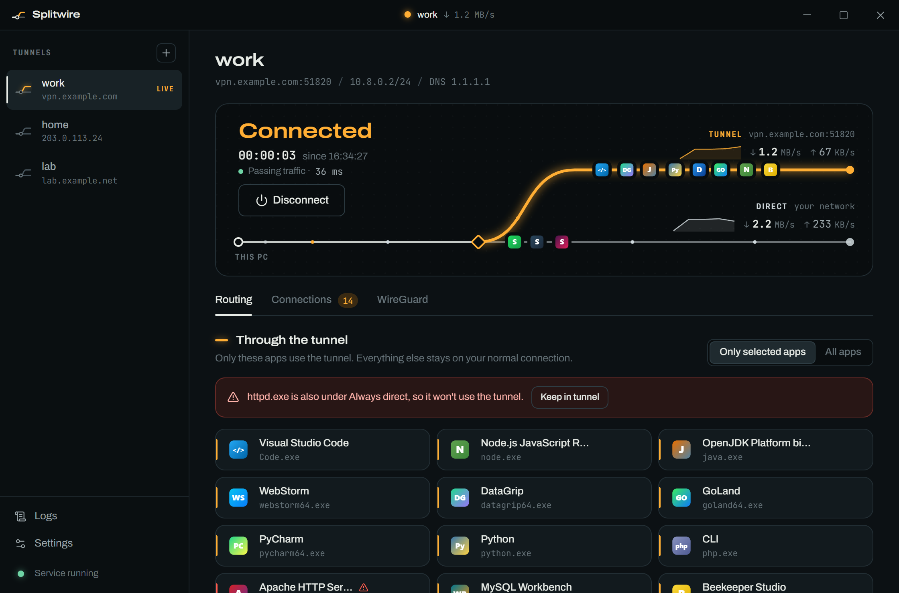
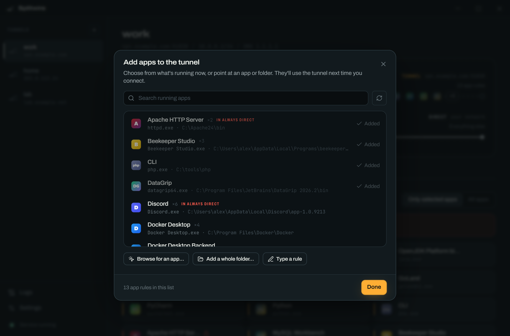
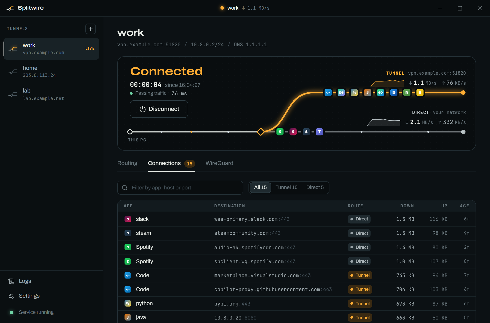

<div align="center">


# Splitwire

**Per-app split tunneling for WireGuard on Windows.**
Choose which apps go through your VPN. Everything else stays on your normal connection.

[](https://github.com/nalyDzzz/splitwire/actions/workflows/ci.yml)
[](https://github.com/nalyDzzz/splitwire/releases/latest)
[](LICENSE)



</div>

## Why

WireGuard for Windows can only split traffic by IP address. Splitwire splits it by **app**:

- Send your IDE, database tools and terminals through the work VPN.
- Keep games, calls and streaming on your normal connection.
- Or tunnel everything except a few apps.

It's free and open source, a replacement for tools like TunnlTo.

## Features

- **Pick apps visually.** Choose from running programs with their real icons, or match by exe name, exact path, a whole folder, or a keyword.
- **Two modes.** Only the selected apps use the tunnel, or every app except a bypass list.
- **See it working.**
  - Live upload and download per route.
  - A live connection list showing which app went where.
  - A health check that proves traffic actually gets through the tunnel, not just that it's "connected".
- **Imports your existing configs.** Standard WireGuard `.conf` files, plus TunnlTo/WireSock `AllowedApps`, `DisallowedApps` and `DisallowedIPs`.
- **Lives in the tray.** Connect, disconnect, launch at login, and auto-connect.
- **Secure by design.** The app runs without admin rights; a small background service does the privileged work. Saved tunnels are encrypted with Windows DPAPI. See [SECURITY.md](SECURITY.md).

<p align="center">
  
  
</p>

## Install

1. Download `Splitwire_<version>_x64-setup.exe` from the [latest release](https://github.com/nalyDzzz/splitwire/releases/latest).
2. Run it. Windows SmartScreen may warn because the installer isn't code-signed yet. Click **More info → Run anyway**.
3. Approve the admin prompt. It installs the background service that runs your tunnels.

Requires Windows 10 or 11 (x64).

### Coming from TunnlTo or WireSock

1. Turn them off first, so the two tools don't fight over your traffic.
2. In Splitwire, choose **Import .conf file**. TunnlTo keeps the tunnel you used last at `%LOCALAPPDATA%\TunnlTo\tunnel.conf`.
3. Your app lists carry over. Splitwire flags apps that are in both lists.

## How it works

```
┌────────────────────────┐   named pipe    ┌──────────────────────────┐
│ Splitwire app          │  (JSON, local   │ splitwire-service        │
│ Tauri + React          │   users only)   │ Windows service, SYSTEM  │
│ runs as you, no admin  │ ──────────────► │ generates engine config  │
│ stores tunnels (DPAPI) │                 │ supervises sing-box      │
└────────────────────────┘                 └────────────┬─────────────┘
                                                        │ config on stdin
                                           ┌────────────▼─────────────┐
                                           │ sing-box                 │
                                           │ TUN adapter captures     │
                                           │ traffic; route rules     │
                                           │ match the process path:  │
                                           │  tunneled → WireGuard    │
                                           │  other apps → direct     │
                                           └──────────────────────────┘
```

The engine is [sing-box](https://github.com/SagerNet/sing-box), pinned and checksum-verified.

A connection goes through the tunnel when all of these hold:

1. Its app is in scope: either all apps, or one of the selected apps.
2. Its app isn't on the bypass list.
3. Its destination is inside the peer's `AllowedIPs`.
4. Its destination isn't on the bypass IP list.

Bypass always wins. If the tunnel has no IPv6 address, tunneled apps' IPv6 traffic is refused rather than leaked, so they fall back to IPv4.

## Good to know

- **DNS is all-or-nothing.** Windows resolves names for every app in one system service, so lookups can't be split per app. Each tunnel either uses your normal DNS or sends every lookup through the tunnel.
- **Local network traffic stays local.** Addresses on your own subnet don't go through the tunnel.
- **Other VPN clients.** Keep other VPNs disconnected while Splitwire is connected. Having them installed is fine.
- **The tray icon matters.** Quitting Splitwire disconnects the tunnel, so nothing keeps routing your traffic without you seeing it.

## Development

See [CONTRIBUTING.md](CONTRIBUTING.md). The short version:

```sh
pnpm install && pnpm fetch:engine
pnpm dev:web     # UI only, in a browser, with demo data
pnpm service     # (elevated terminal) the background service
pnpm dev         # the full app
pnpm test        # includes a real WireGuard handshake end to end
pnpm build       # the installer
```

## Roadmap

- OpenVPN and OpenConnect tunnels (sing-box already ships both)
- Several tunnels at once, each with its own apps
- Kill switch: block tunneled apps when the tunnel drops
- Split DNS for chosen domains
- Signed installer and auto-update
- A slimmer engine build (the stock sing-box is ~80 MB unpacked)

## License

[GPL-3.0-or-later](LICENSE). Splitwire bundles [sing-box](https://github.com/SagerNet/sing-box) (GPL-3.0); its license ships with the installer.
